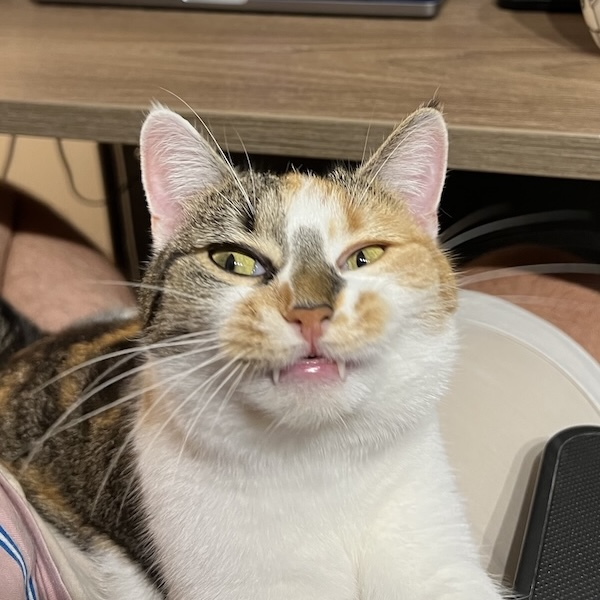

# Hello world

This first paragraph becomes the summary on the news list and in link previews, so make it count.

## A section

Regular **Markdown** works: *italics*, [links](https://github.com/BRobat), lists, quotes and code.

- one
- two

> A quote.

Images and GIFs go next to this file. Both `` and Obsidian's `![[photo.jpg]]` work.
The first image is used as the preview image when the link is shared.
