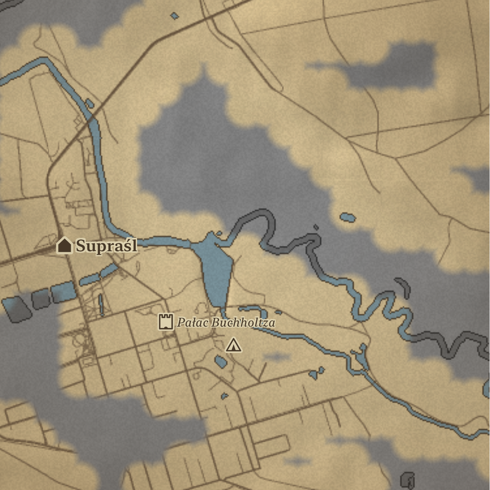

# Morrowind-like map

App that uncovers areas visited while running or hiking on a rpg styled map.

The map has a fog of war: it stays hidden until you've been there. Areas are revealed from the GPS routes your watch already records on runs, hikes and rides, so the app never turns on GPS itself.

Terrain comes from free sources with no API keys (AWS Terrain Tiles for elevation, OpenFreeMap for water) and is rendered on the device. right now only on iOS/watchOS

Source: [github.com/BRobat/morrowind-like-map](https://github.com/BRobat/morrowind-like-map)
