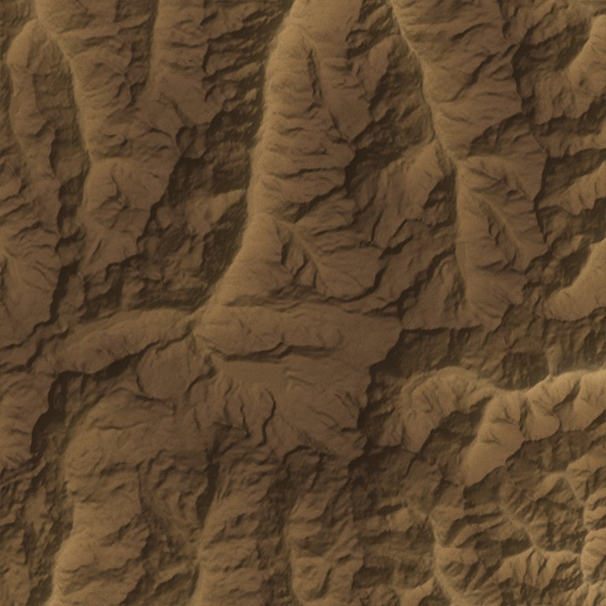

# Morrowind-like map

A maps app that draws real terrain in the style of the in-game map from *Morrowind* and 

The map has a fog of war: it stays hidden until you've been there. Areas are revealed from the GPS routes your watch already records on runs, hikes and rides, so the app never turns on GPS itself.

Terrain comes from free sources with no API keys (AWS Terrain Tiles for elevation, OpenFreeMap for water) and is rendered on the device. iOS and watchOS come first; Garmin and Wear OS are planned.

Source: [github.com/BRobat/morrowind-like-map](https://github.com/BRobat/morrowind-like-map)
