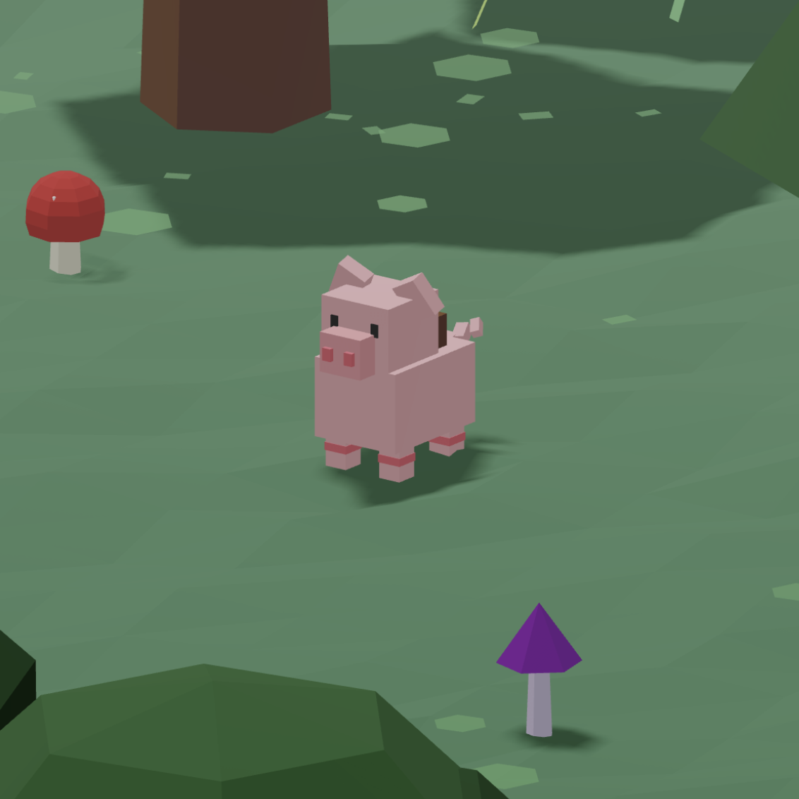

# Mushroom Picking demo

An early version of mushroom picking. It's somewhat playable.

A cozy game where you travel through the woods searching for mushrooms. There are many mechanics which could be found in the later iteration of the game.

This one was made with threejs which unfortunately didn't stand to the requirements I needed. There are some interesting performance tricks made to make it less resource intensive like variable refresh rate for every entity. Yet it still was beaten by Godot bby a vast margin. Maybe I could get more out of threejs in that matter.
