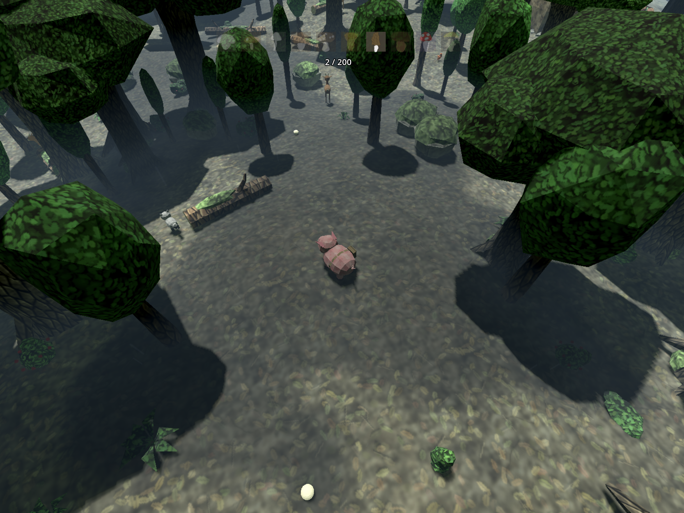

# Mushroom Picking

A more mushroom picking game. My main project currently.

A cozy game ideal for after a hard day at work. Pick mushrooms, do some errands and explore a weird island.

It all started with an idea to make a game quickly in my spare time during autumn of 2025. I supposed I would finish right at the end of the mushroom picking season but how I was wrong. After spending many hours working on threejs version of the game, during the spring 2026 I've decided that it's time to change tools and move to a proper game engine. I've chosen godot as it's quite suited for low demanding games.

While this project at it's core serves as a way of creating an engine for procedurally generated RPG game, it gained a lot of personality so I'm eager to finish and finally release it one day.

There are quest lines, towns connected by roads, relationships between npcs and of course deep lore with main storyline.

