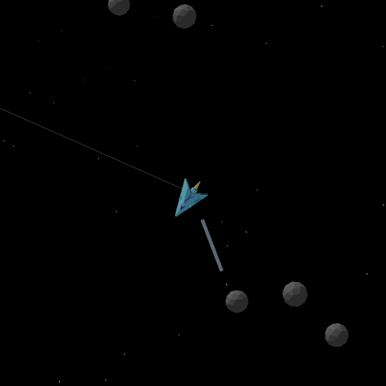

# Orbit Trader demo

A POC of a game with orbital movement as the main mechanic. Currently on hold.

Well, another project inspired by Ev Nova. Guess I really like these ships!

It's a simple POC of a game which let's player travel between planets in a sci-fi but physically realistic manner using flip-and-burn maneuver. With some trade mechanics and space rocks sprinkled over. 