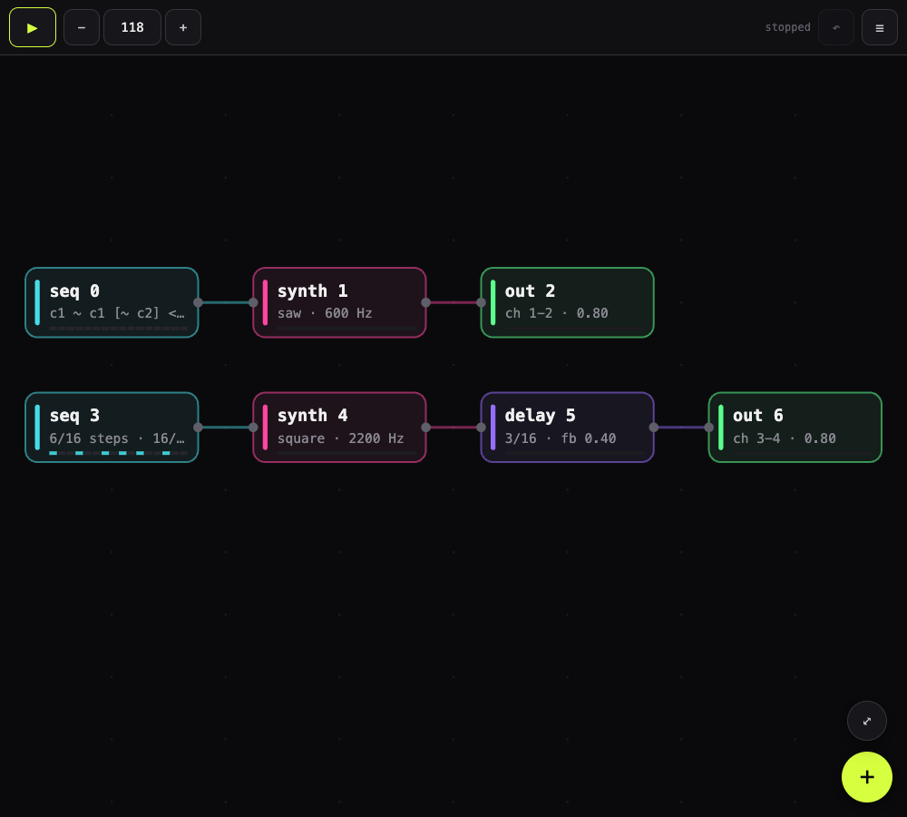

# Robat Synth

A keyboard-driven, node-based synthesizer for live-coded, algorave-style performance, written in Rust with web version as well.

Intentionally this synth is to be run on desktop using only keyboard. Making use of the tidal-cycles like notation it's possible to make complex melodies.

On the desktop it streams multichannel audio into Logic Pro: each `out` node writes to its own stereo pair, so every voice lands on its own track. The same engine is compiled to WebAssembly for the browser version, which has a touch UI for phones.

Source: [github.com/BRobat/Robat-synth](https://github.com/BRobat/Robat-synth)
