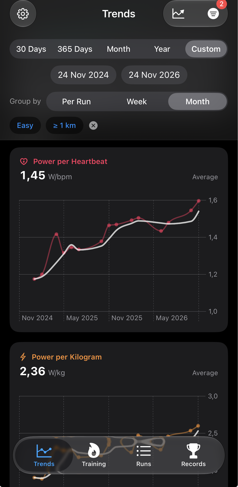

# Running stats

Running stats app for nerds.

As of 2026 I track my running performance on apple watch. And the build-in health app on iOS has many issues that make it useless.

Firstly it current month/year, not last 30 days. So Stats at the beggining of the year or month are useless.

Secondly it has no actualy useful data such as Watts per heartbeat.

Third thing which is sorting over easy/long/tempo runs.

And lastly (as of early iOS 27) it sorts even the pinned statistics every time I open the app which drives me crazy (it does the sorting roughly ~3 seconds after the app opens).

All of these issues are addresed in this app which might be quite inaccessible for normal people, but suits my needs as a comprehensible running log.

