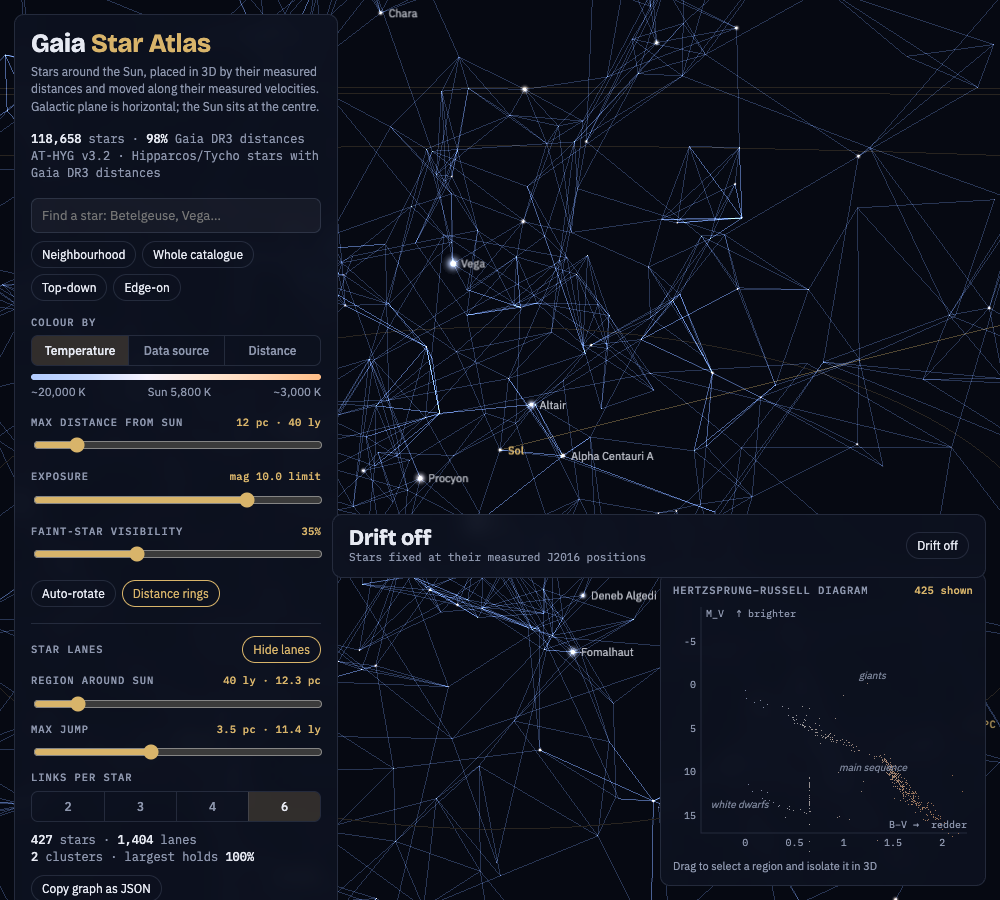

# Gaia Star Atlas

A 3D map of stars around the Sun, inspired by Gaia catalogue and Ev Nova star map.

- Stars sized and lit by apparent magnitude, with the Sun at the centre.
- Stellar drift over ±5 million years with motion trails, plus a Gliese 710 flyby preset.
- "Star lanes": a nearest-neighbour graph with route-finding between stars.
- A Hertzsprung–Russell diagram where you can box-select stars and isolate them in 3D.

Built with three.js and no build step; the data is prepared with Python (pandas, numpy, scipy) from the AT-HYG catalogue.

Source: [github.com/BRobat/Star-catalogue](https://github.com/BRobat/Star-catalogue)
