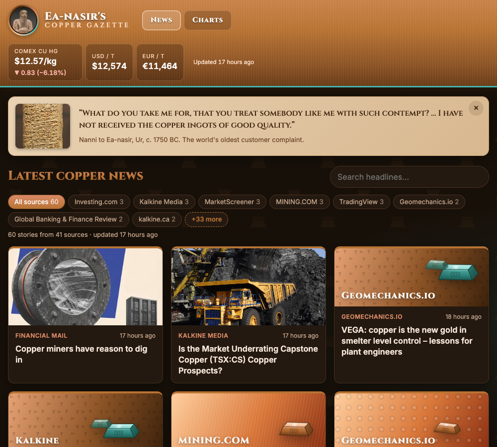

# Ea-nasir's Copper Gazette

A news aggregator for copper, a meme, high quality (not really).

It's a fun story (maybe), a friend sent me too many Ea Nasir memes alongside when I've replaced my social media feed with industry news (like metallurgy, energy etc.). So after one meme too many I've decided to make a platform for only copper news. Here it is.

- **News:** copper headlines collected from RSS feeds (Google News queries and trade publications), filtered by keyword.
- **Charts:** copper and copper-miner price history with a 1M–5Y range picker, a crosshair and a table view.
- **Ticker:** COMEX copper futures and EUR/USD, with a "stale" badge when the latest fetch fails.

Browsers can't read RSS feeds or Yahoo Finance directly because of CORS, so a scheduled GitHub Action does the fetching and commits the results as JSON. The site itself is static and hosted on GitHub Pages.

Source: [github.com/BRobat/udrea](https://github.com/BRobat/udrea)
